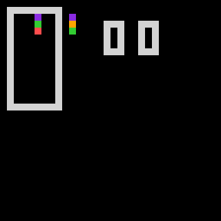
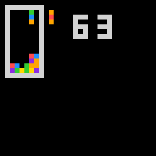
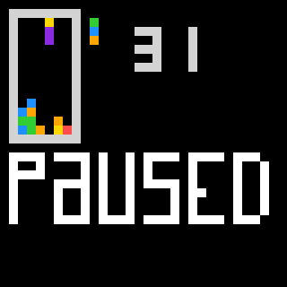
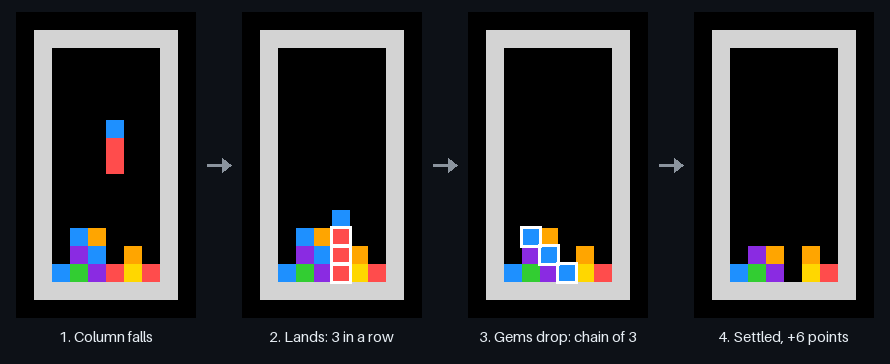
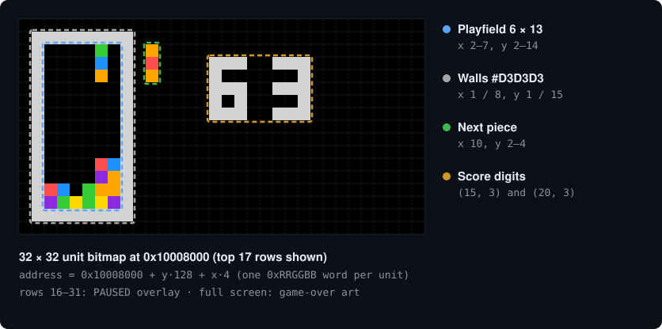
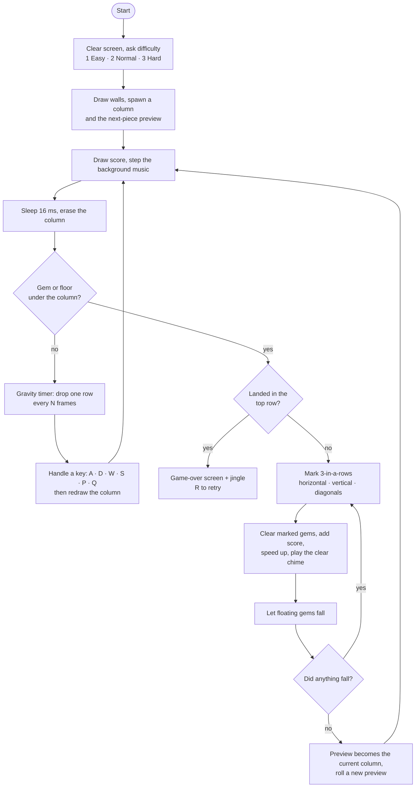

# assembly-column-game

A clone of Sega's **Columns** written entirely in MIPS assembly for CSC258, by Lu Wang and Xiaotong Shen.
It runs in the [Saturn](https://github.com/1whatleytay/saturn) MIPS IDE, drawing to the memory-mapped bitmap display and reading the memory-mapped keyboard.

<p align="center">
  
</p>

<p align="center"><sub>Real output, not a mock-up: <code>columns.asm</code> running on Saturn's MIPS emulator with a bot at the keyboard (see <a href="#regenerating-the-visuals">how it was recorded</a>).</sub></p>

**Implemented:** Easy features 1, 2, 3, 4, 5, 6, 10 · Hard features 1, 5

## Screens

| Playing | Paused | Game over |
| :---: | :---: | :---: |
|  |  |  |
| Well, next-piece preview, score | `P` pauses and resumes | Shown when the stack reaches the top |

## How to play

A column of three gems falls into a 6 × 13 well. Shift it, cycle its colours, and line up **three or more of the same colour** horizontally, vertically or diagonally to clear them. Gems above a cleared gap fall, and any new lines they form clear too: a chain reaction. Every gem cleared is one point. Each clear also speeds gravity up a little.

| Key | Action |
| :---: | --- |
| `A` / `D` | Move the column left / right |
| `W` | Cycle the colours (each gem moves up one; the top gem wraps to the bottom) |
| `S` | Soft drop one row |
| `P` | Pause / resume |
| `Q` | Quit (shows the game-over screen) |
| `R` | Retry. Press it while the game-over jingle plays |

At launch the console asks for a difficulty, which sets how many 16 ms frames pass before gravity drops the column one row:

| Difficulty | Frames per row | Approx. fall speed |
| --- | :---: | --- |
| 1 · Easy | 32 | ~0.5 s per row |
| 2 · Normal | 24 | ~0.4 s per row |
| 3 · Hard | 16 | ~0.25 s per row |

Each clear removes one frame from that interval, down to a floor of 11.

## Matching and chain reactions

<p align="center">
  
</p>

When a column lands, four scanners sweep the well for three equal, non-empty cells in a row: `mark_line` (horizontal), `mark_vertical`, `mark_right_diagonal` and `mark_left_diagonal`. Matches are flagged in a separate 6 × 13 `grid` buffer, not erased right away, so one gem can belong to several lines at once. `clear_marked_piece` then erases every flagged gem and adds it to the score. `fall` drops floating gems, and the whole check repeats until nothing moves. The strip above is a real two-step chain from the recorded game.

## Under the hood

### Bitmap display layout

<p align="center">
  
</p>

Every unit of the 32 × 32 display is one 32-bit `0xRRGGBB` word starting at `0x10008000`, so a cell's address is `0x10008000 + y·128 + x·4` (`get_address` / `get_offset`). The game reads the display back as its board state: collision checks, matching and gravity all inspect the colours already on screen.

### Game loop



### Sound

All audio uses Saturn's MIDI syscalls (31 = play, 33 = play and wait):

- **Background music:** an arpeggiated A minor → G → F → E progression, one chord every 50 frames.
- **Clear chime:** a falling A5 → E5 → C5 on every clear.
- **Game over:** a I – IV – V7 – I cadence in C.

### Pixel-art screens

The pause banner, the game-over screen and the full-screen clear are drawn as PNGs in `assets/art/`. `assets/generate_png_data.py` converts each one into a list of `(offset, colour)` word pairs (`assets/*.s`), which `columns.asm` pulls in with `.include`. The `load_asset` macro paints them at any offset.

## Running it in Saturn

1. Install [Saturn](https://github.com/1whatleytay/saturn/releases) and open `columns.asm`. Keep the `assets/` folder next to it, since the art is pulled in with `.include`.
2. In the **Bitmap** tab set **Display Width 32 / Units 1**, **Display Height 32 / Units 1**, and **Address `0x10008000`** (`$gp`). Saturn's default is 64 units wide, which makes the rows wrap.
3. Run the program, type `1`, `2` or `3` in the console for the difficulty, and press Enter.
4. Click the bitmap display so it receives keyboard events, then play.

## Regenerating the visuals

Everything in `docs/` comes from actually running the game: [`tools/saturn-capture`](tools/saturn-capture) is a small Rust program built on Saturn's own backend (`saturn_backend` + the `titan` MIPS emulator). It:

- assembles `columns.asm` with Saturn's assembler and types the difficulty into the console;
- swaps the wall clock for a virtual one, so every `sleep` syscall is exactly one deterministic frame;
- plays with a greedy bot that reads `cur_x`, `cur_y` and the colours from memory, searches every column and rotation (with one piece of lookahead), and presses keys through Saturn's keyboard MMIO;
- dumps the bitmap memory at `0x10008000` on every frame.

```sh
cd tools/saturn-capture
cargo run --release -- ../../columns.asm run 2           # difficulty 2, ~30 pieces, writes run/frames.bin
python3 -m venv .venv && .venv/bin/pip install -r render/requirements.txt
.venv/bin/python render/render.py run ../../docs          # GIF, stills, chain strip, display map
```

Piece colours are random, so every run plays out differently.

## Repository layout

| Path | Contents |
| --- | --- |
| `columns.asm` | The whole game |
| `assets/` | Pixel art (`art/*.png`), the generated `.s` data files, and the converter script |
| `docs/` | README images, rendered from Saturn runs |
| `tools/saturn-capture/` | Headless Saturn runner and renderer used to make `docs/` |
| `assembly-column-game-main/` | An earlier snapshot of the project (before background music) |
